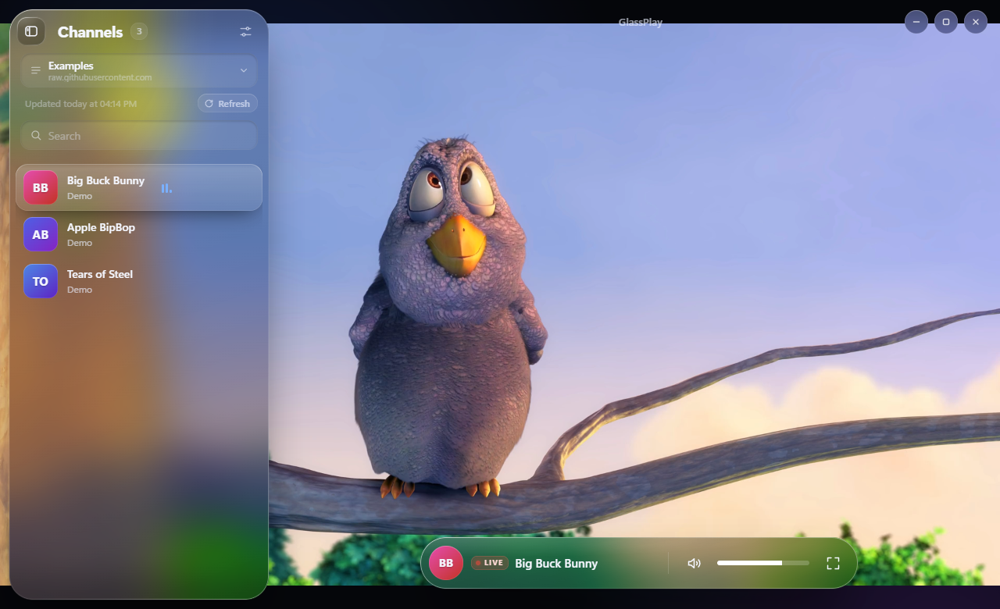

# GlassPlay



A streaming channel player for **Windows**, **macOS** and **Android** (phones, tablets and Android TV)
with a *Liquid Glass* look. The backend is written in Rust with [Tauri 2](https://tauri.app); the
interface is plain HTML/CSS/JS shipped inside the app and rendered by the system WebView
(WebView2 on Windows, WebKit on macOS, Android System WebView).

GlassPlay is a player only: it does not provide any channels or lists.

## Features

- **Multiple lists** by URL (JSON or M3U/M3U8) or from a local **M3U file**, each with its own name.
  A list is saved only if it downloads and parses correctly; a local copy is kept so the app opens instantly.
- **Huge lists**: virtual scrolling handles hundreds of thousands of channels.
- **Folders** (create, rename, reorder, delete, drag & drop) and **pinned** channels, per list.
- **Hover preview** (desktop) after 1 second, muted and at the lowest quality.
- **Now playing**: program title from the stream (DVB EIT tables) or from the Xtream Codes guide.
- **Subtitles**: DVB bitmap subtitles decoded in Rust, plus WebVTT tracks and CEA-608/708 captions.
- **Xtream Codes** panels: MPEG-TS links are played through their HLS variant.
- **Android TV**: full remote-control navigation and a launcher banner.
- **13 languages** (system language by default): IT, EN, ES, FR, DE, RO, PL, RU, UK, TR, ZH, JA, KO.
- Remembers window size/position and fullscreen (desktop), volume, last channel and last list.

## Download

Ready-made builds are attached to each [release](../../releases):

| File | Platform |
|---|---|
| `GlassPlay-<version>-windows-x64.exe` | Windows 10/11, 64-bit (uses the system WebView2, no installation) |
| `GlassPlay-<version>-macos-universal.dmg` | macOS 11 or later, Apple Silicon and Intel |
| `GlassPlay-<version>-android.apk` | Android 7+ phones, tablets and Android TV |

The builds are not signed with paid developer certificates, so the systems warn on first launch:

- **Windows**: SmartScreen → *More info* → *Run anyway*.
- **macOS**: open the `.dmg` and drag GlassPlay to *Applications*. On first launch macOS blocks it:
  open *System Settings → Privacy & Security* and choose *Open Anyway* (or right-click the app → *Open*).
  If macOS says the app "is damaged", run once in Terminal:
  `xattr -dr com.apple.quarantine /Applications/GlassPlay.app`
- **Android**: allow installing apps from unknown sources for your browser or file manager.

## Controls

**Keyboard (Windows, macOS)**

| Key | Action |
|---|---|
| ↑ / ↓ | Previous / next channel |
| ← / → or mouse wheel | Volume |
| M | Mute |
| C | Subtitles on/off (when available) |
| R | Reload channel |
| F, F11 or double click | Fullscreen |
| S | Show/hide the channel panel |
| / | Search |
| Esc | Step back (panel → fullscreen → quit) |

**Android TV remote**: while watching, ↑/↓ change channel, ←/→ change volume and OK opens the
channel panel. In the panel and in menus the arrows move the selection and OK activates it.
**Back** steps back (menu → panel → quit confirmation), also on phones.

## Supported list formats

**JSON**: an array of objects, also nested (`{"channels": [...]}`, `{"data": {"items": [...]}}`, …).
Field names are matched loosely:

- name: `name`, `title`, `label`, …
- image: `image`, `logo`, `icon`, `thumbnail`, …
- stream: `url`, `stream`, `link`, `m3u8`, `src`, …
- group (optional): `group`, `category`, …

**M3U/M3U8**: IPTV playlists with `#EXTINF` (`tvg-logo`, `group-title`). A URL pointing to a single
HLS stream becomes one channel. See `examples/channels.json` for a small example.

## Building

Requirements: [rustup](https://rustup.rs) and, on Windows, the Visual Studio Build Tools (C++ workload).

```powershell
.\build.ps1            # Windows executable  -> dist\GlassPlay.exe
.\build.ps1 -Test      # unit tests
.\build.ps1 -Android   # Android APK          -> dist\GlassPlay.apk
```

The script always uses rustup's default toolchain (even if another `cargo` is on the PATH) and
strips local paths from the binaries (`--remap-path-prefix`).

### macOS

Apple apps can only be built on a Mac. The repository includes a GitHub Actions workflow
(`.github/workflows/macos.yml`) that builds a universal `.dmg` on GitHub's macOS runners and attaches
it to the release; it runs automatically when a release is published, or manually from the *Actions* tab.

To build on your own Mac (with Xcode command line tools):

```sh
rustup target add aarch64-apple-darwin x86_64-apple-darwin
npx @tauri-apps/cli@2 build --target universal-apple-darwin
```

The macOS settings (native window buttons, `.dmg` bundle, ad-hoc signing) are in
`src-tauri/tauri.macos.conf.json`.

### Android

Additional requirements: Android SDK with an NDK (e.g. via Android Studio), JDK 17 (`JAVA_HOME`),
the Rust Android targets and the Tauri CLI:

```powershell
rustup target add aarch64-linux-android armv7-linux-androideabi i686-linux-android x86_64-linux-android
cargo install tauri-cli --version "^2" --locked
```

`ANDROID_HOME` defaults to `%LOCALAPPDATA%\Android\Sdk` and the newest NDK inside it is used.
To produce an installable (signed) release APK, create `src-tauri/gen/android/keystore.properties`:

```properties
storeFile=C:/path/to/your-release-key.jks
keyAlias=your-alias
password=your-password
```

Without it the release APK is built unsigned. Keystores and `keystore.properties` are git-ignored.

### Icon

The icon, the Android TV banner and the macOS `.icns` source are generated by code (original design):

```powershell
cargo run --release --manifest-path tools\icongen\Cargo.toml -- src-tauri\icons
```

## Project layout

- `src-tauri/src/lib.rs`: Tauri commands (lists, downloads, saved copies), shared by all platforms
- `src-tauri/src/playlist.rs`: JSON and M3U parsing
- `src-tauri/src/proxy.rs`: `stream://` proxy for the player (CORS, absolute playlist URLs, metadata)
- `src-tauri/src/dvbsub.rs`: DVB subtitle decoder (ETSI EN 300 743)
- `src-tauri/src/meta.rs`: program title (DVB EIT, Xtream guide)
- `src-tauri/src/settings.rs`: settings and saved lists in the app data folder
- `ui/`: interface (glass design, virtual list, player built on hls.js), translations in `ui/i18n.js`

## Known limitations

- Plays HLS (`.m3u8`) and the WebView's native formats (MP4/WebM); continuous raw MPEG-TS
  streams without a playlist are not supported.
- AC-3/E-AC-3 audio and, depending on the system, HEVC video are not decoded by the WebView.
- Teletext subtitles are not supported.

## License

MIT, see [LICENSE](LICENSE).

Includes [hls.js](https://github.com/video-dev/hls.js) (Apache License 2.0) in `ui/vendor/hls.min.js`.
